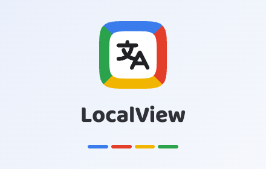
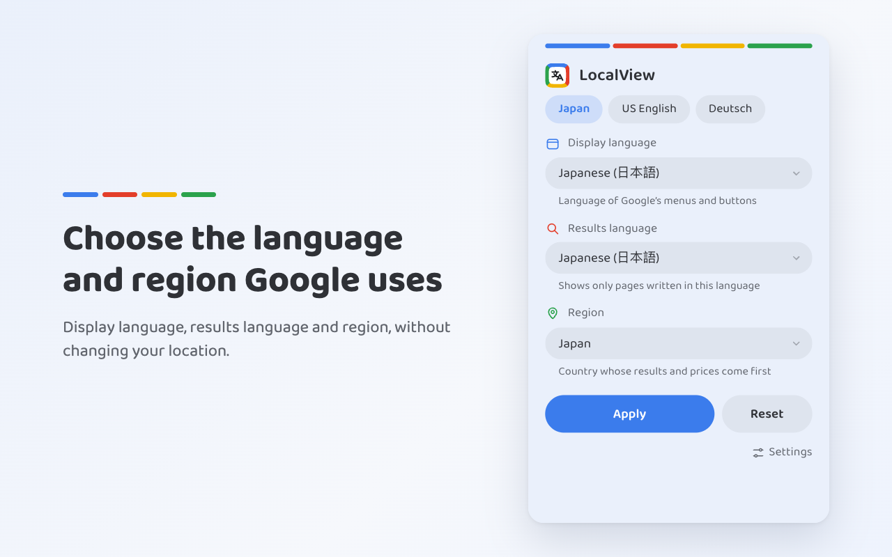

  

  Choose the language and region Google uses, without a VPN and without changing your location.

## Features

- **Display language, results language and region** for Google Search, Maps,
  Images, News, Shopping, Videos, Books, Flights and Hotels.
- **Saved choices**: switch between combinations with one tap.
- **Per-product settings**: for example Maps in Japanese, everything else in English.
- **No reloads or flashes**: settings apply as the page loads.
- **12 interface languages**, with light and dark themes.

Made for people living abroad, travellers, language learners, and anyone who
wants to see what Google shows in another country.

## Privacy

LocalView collects no data and sends nothing anywhere. It runs only on Google
sites. See the [privacy policy](PRIVACY.md).

Google is a trademark of Google LLC. LocalView is not affiliated with or endorsed by Google.
